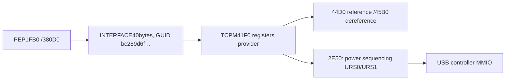

# Повторный разбор1851: две точки BSOD и протокол PEP↔TCPM

28.10.2026. Прочитаны актуальные заметки второй сессии, исходники1851,
результаты её тестов и прошлый разбор краша. Выполнены чтение текущей
конфигурации ОС,45 power samples, Ghidra и offline-проверки реальных PE.
Установок, отката, USB reset, перезагрузок и переключений кабелей не было.
Через обычный UAC только скопирован защищённый второй минидамп для чтения.

## Текущая связка подтверждена

|Компонент|INF версия / OEM|SHA256 SYS, начало|
|---|---|---|
|PMIC extension|1849 / oem141|441D764844DBDB84|
|Type-C backend|1851 / oem92|7CC45346517C7DBE|
|TCPM client|1851 / oem142|B2197B3733AB4ABA|
|Battery manager|10731 / oem144|A0CD3D2D5C680039|
|Battery miniclass|1680 / oem143|7F7ECE18BF7ED438|
|PEP|PE FileVersion2140|39FAFCD60536C7D3|

Полные хеши: current-service-identities.json. Старый oem92 больше нельзя
трактовать как PMIC1840: номер теперь занят backend1851.
Зафиксирован boot28.10 в16:57:45+05. Видимые relevant PnP nodes имеют
ProblemCode0; Kingston XS2000 присутствует.45 снимков ОС: AC1, flags9,90%.
Это стабильность данного подключённого powered hub, не тест отключения
зарядки, не чтение PMIC-регистров и не измерение зарядного тока.
Хеши настроенных файлов не равнозначны чтению загруженной памяти ядра.

Пользователь уточнил: в Android этот SSD не поддерживается, обычная флешка
работает. Android не трогали. Прежние сообщения об Android не доказывают
возможность непрерывной работы именно SSD при смене питания хаба.

## 1. Второй реальный BSOD, которого не было в подробном прошлом отчёте

В System найдено сообщение о102726-10640-01.dmp. Скопирован исходный файл,
SHA256 C1E2461C0DC563CEF08056AE5083FFC219C0B707CAB2262898DC12A22FD8AA34.
WinDbg/cdb:0x7E, exceptionC0000005, qcusbctcpm8150+8ABC,
`LDR X1,[X19,#0x80]`, X19=0, чтение адреса80.

После подстановки точных образов1851 восстановлен стек:

```text
backend worker100A0 -> RepairDispatch21380 -> original10C68
  -> state dispatch117A8 -> notification10E48 -> E108
  -> client89E0 -> WdfObjectGetTypedContextWorker returnsNULL
  -> client8ABC dereferencesNULL+80
```

Checksum/SizeOfImage/Timestamp образов в дампе совпадают с пакетами1851.
CallbackE108 проверяет старый ready1A818 и адрес callback, затем вызывает
client с сохранённым handle. Client89E0 не проверяет результат typed-context
lookup. Адрес в регистре X20 также попал в записанный диапазон **выгруженного**
UcmTcpciCx. Минидамп не содержит нужных страниц глобальной callback-таблицы:
первопричина неверного handle/исчезнувшего контекста ещё не доказана.
Поздний callback после teardown — существенная гипотеза, не установленный
момент удаления объекта и не доказательство, кто первым испортил handle.

Новый test_late_alert_link.py исполняет реальный E108 backend1851 и89E0
client1851 вместе. WDF/class DDIs заменены моделями.9 случаев воспроизводят
тот же8ABC/X19=0/read80. Есть контрпример: ready очищается уже внутри lookup,
но ранее допущенный callback всё равно падает. Одного сброса ready недостаточно;
нужно прекращение допуска, ожидание ранее допущенных уведомлений и только
потом уничтожение controller/class binding. Null guard — дополнительная защита.

Временные отметки System и заголовка дампа расходятся: debugger показывает
27.10 18:37:16+05/uptime58:43, Event1001 —17:38:45+05. Обе сохранены;
точный интервал до физического действия пользователя из них не выводится.

## 2. PEP lifetime: проверен настоящий получатель, а не прежняя заглушка

Предыдущий0x13A/qpeY и stale buffer в PEP380D0 остаются подтверждёнными
прошлым разбором. Удержание24-byte buffer устраняет воспроизведённый Free/UAF,
но прошлый прототип нельзя считать готовым исправлением всего протокола.

Новый разбор связывает:



DeviceClasses этого GUID указывает на ACPI QCOM057D.41F0 экспортирует
callback2E50, reference44D0, dereference45B0. Они побайтно совпадают у
исходного1680 и установленного client1851. Ghidra подтверждает обработчик
для имён `\_SB.URS0` и `\_SB.URS1`. Он управляет регистрами USB-контроллера;
это не показание тока зарядки и не самостоятельное решение о data role.

test_pep_provider_link.py связывает реальный PEP с настоящими функциями
получателя. DDI/платформа моделируются, MMIO — обычная память эмулятора.
9 сценариев дают дополнительные результаты:

- Первый запрос с flag1 до любого flag0 передаёт нулевой String.Buffer:
  PEP выделил/обнулил24bytes, но заполняет имя только в другой ветви.
  Provider падает на2E84 при чтении NULL-строки. Такой порядок на железе
  пока не зафиксирован; это контрпример к полноте протокола/прежних тестов.
- Старый fixture `USBHOST` настоящий provider отвергает сC000000D;
  оба действительных ACPI-имени приняты в проверенной ветви. Старый тест
  не исполнял этот handler, поэтому не проверял совместимость payload.
- При1/10/256 arrival/removal прототип вызывает реальные Reference1/10/256
  раз, Dereference0 раз. Byte-counterC590 после256 становится0. В этих
  функциях нет pin/rundown объектов или MMIO. Это не доказательство
  конкретного нового heap leak, но такой счётчик не обеспечивает lifetime.
- С удержанным buffer PEP продолжает вызывать provider после закрытия
  target. Без согласованного interface lease/rundown безопасность не доказана.
- Исходный PEP снова даёт UAF, теперь при вызове настоящего provider.

Нужны подготовка полного пакета для обоих путей **до** публикации готовности,
сбалансированные interface references, обработка Query/Allocate failure,
защищённое завершение callbacks и действительность MMIO текущего поколения.
Отключать весь PEP или просто не освобождать buffer недостаточно.
[Контракт INTERFACE](https://learn.microsoft.com/en-us/windows-hardware/drivers/ddi/wdm/ns-wdm-_interface)
требует освобождать полученную ссылку после использования.

## 3. Значок AC и фактическая зарядка: Android различает несколько состояний

В Ghidra заново разобраны функции исходного Android ELF:

|Функция|VA|Основной источник|
|---|---|---|
|smblib_get_prop_usb_present|FFFFFF8008C99720|1310.bit4 — наличие входа|
|smblib_get_prop_usb_online|FFFFFF8008C9B180|110B.bits4&0 — используемый/валидный вход|
|smblib_get_prop_batt_status|FFFFFF8008C9ACC8|USB/DC online и1006 — состояние charger|

Все три диапазона памяти проекта Ghidra побайтно сверены с исходным
vmlinux_v2.elf. Источники/адреса/SHA: android-online-original-bytes.json.
Android имеет отдельные исключения для JEITA, termination и pump; их нельзя
копировать как универсальное правило «всегда показывать зарядку».

Для Windows нужно различать источник питания, свою выдачу OTG, входной
power path и состояние батареи. VBUS от самого планшета не означает AC.
После подтверждённого снятия внешних источников нужно обновление статуса
battery и уведомления ОС; ошибка чтения не равна достоверному detach.
Менять один значок или вслепую снимать suspend нельзя.
Зависший AC по сообщению пользователя сегодня **не воспроизводился**:
текущее подключение оставалось запитанным. Его точная причина ещё не установлена.

Текущий PMIC —1849, а не1850. Read-Pmic1850 Capture здесь не запускался:
его private protocol разрешён только для другого точного SYS-хеша.

## 4. Потеря SSD и порядок следующей реализации

Сохранённая трасса1851 доказывает удаление/создание UCX/xHCI и новое
перечисление SSD. Она не позволяет приписать конкретный reset только
снятию PD: точного времени физических действий в прошлом тесте нет.
Microsoft различает [power-role update](https://learn.microsoft.com/en-us/windows-hardware/drivers/ddi/ucmmanager/nf-ucmmanager-ucmconnectorpowerdirectionchanged)
и [data-role update](https://learn.microsoft.com/en-us/windows-hardware/drivers/ddi/ucmmanager/nf-ucmmanager-ucmconnectordatadirectionchanged).
[URS загружает/выгружает роли](https://learn.microsoft.com/en-us/windows-hardware/drivers/usbcon/usb-dual-role-driver-stack-architecture).
Это рабочая цепочка для расследования, не доказанный виновник каждого сброса.

1. Согласованно закрыть две границы callback lifetime: backend↔client/class
   и PEP↔TCPM provider. Проверить поздние уведомления, Query/Allocate failure,
   первый flag1, повторное подключение и удержание MMIO. До SYS-hook надо
   установить ABI/error contract вызывающих функций и порядок teardown.
2. Доставлять новый power-source/battery status по подтверждённому состоянию,
   отдельно от data role. Добавить наблюдаемость snapshot age/generation,
   confirmed detach и ошибки источника; не маскировать их старым AC.
3. Проверить источник изменений URS/data role и сохранять Host при одной
   смене питания, пока data partner действительно остаётся подключённым.
4. После этих изменений — QA обоих PE вместе, потом ограниченный аппаратный
   тест. Непрерывность I/O требует также непрерывного питания хаба/SSD;
   поддержка такого перехода именно этим хабом пока не установлена.

Новый установленный драйвер сегодня не создавался.1851 остаётся текущей
экспериментальной связкой с известными отказами; полной исправности нет.
