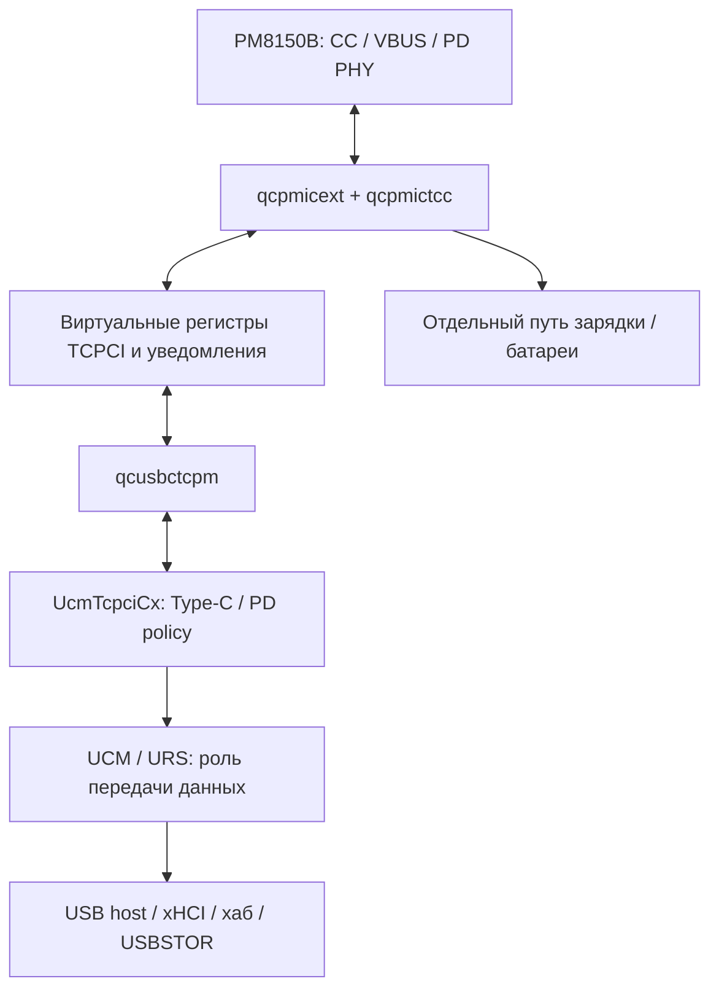

> Уточнение 27.10: статическая сверка настоящего backend показала два канала результата и неполноту прежней модели. **Transportfix2 / safetyfix3 не пригодны для установки**. Старые числа проверок относятся только к прежним ограниченным сценариям. Новых тестов и установок нет. Подробности: [новый разбор](TYPEC-NOTIFICATION-CONTRACT-2026-10-27.md).

# Продолжение: связка Android → TCPCI → Windows, 27.10.2026

На планшете остаются исходные **PMIC1840/oem92, USB-C1680/oem110**.
Ничего не установлено, устройства не перезапускались, реальное питание
не переключалось. Все проверки ниже выполняют сохранённые ARM64-инструкции
в Unicorn или Windows unwinder в обычном пользовательском процессе.

**Результат: найдены дополнительные воспроизводимые дефекты исходного
USB-C1680 и подготовлены отдельные офлайн-кандидаты. Это не доказательство,
что каждый наблюдавшийся сбой вызван ими, и не готовая стабильная версия.**

## 1. Полный PD-движок уже есть в Windows

В qcusbctcpm8150.sys есть binding `UcmTcpciCx`. Таблица API/заголовки WDK
сопоставлены с машинным кодом. Microsoft предоставляет в этом расширении
движок Type-C/PD. Поэтому задача — прежде всего исправить мост Qualcomm,
а не начинать с переноса всего Linux PD в Windows.
[Описание Microsoft](https://learn.microsoft.com/en-us/windows-hardware/drivers/usbcon/write-a-usb-type-c-port-controller-driver).

Android реализует соответствующие звенья через smblib, USB-PD policy,
regulator, extcon, DWC3 и зарядную политику. Состояние Host не тождественно
состоянию Source: хост данных с ролью Sink питания нужен powered-хабу.
Физическая потеря питания самого моста SSD остаётся отдельным ограничением.

## 2. Проверенная карта обработчиков Windows

Адреса — RVA точного qcusbctcpm с SHA
`7C63F4A4B8A9EE0F49B427B6AC94867D2475E02F85D92D5FBCFE4A8AA1804067`.

| RVA | Путь |
|---|---|
|6170|GET_STATUS: читает CC1D, Power1E и Fault1F; успешный выход сообщает3 байта |
|6620|GET_CONTROL: TCPC19, Role1A, Fault1B, Power1C |
|6B40|SET_CONTROL → выбранный регистр19/1A/1B/1C |
|7090|SET_TRANSMIT → регистр50; **это не COMMAND/Look4Connection** |
|7390|SET_TRANSMIT_BUFFER →51 |
|7690|SET_RECEIVE_DETECT →2F |
|7990|SET_CONFIG_STANDARD_OUTPUT →18 |
|7EB0|SET_COMMAND →23; здесь команды44/55/66/77/99 и другие |
|81A0|SET_MESSAGE_HEADER_INFO →2E |
|8E38 /8FC8|Общие read/write через private backend; здесь потеря статуса и lock leak |

Это уточняет прежнее общее название7090 «command»: адрес50 обозначает
передачу PD-пакета, а командный регистр TCPCI —23.
Сопоставление выполнено по WDK26100 `UcmTcpciSpec.h`,
`UcmTcpciPortControllerRequests.h` и свежему Ghidra.

Backend qcpmictcc отдельно ведёт виртуальный cache. F178 обновляет bytes
cache по адресу context+10+register; FAD8 сравнивает CC/Power и выставляет
alert bits;10E48 участвует в передаче уведомления клиенту. AB48 отправляет
PMIC role request802A0FAC, AF20 управляет OTG через801C0FAC.
Виртуальный регистр TCPCI и физический регистр PMIC — разные адресные пространства.

Свежие отчёты: `ghidra/typec-deep-original.txt`,
`typec-tcpci-command-map.txt`, `typec-backend-deep.txt`,
`typec-backend-notify.txt`, `windows-decompiled-c/`.
Для точной упаковки параметров при неточной декомпиляции используются
инструкции ARM64; псевдокод Ghidra не считается оригинальным исходником.

## 3. Дефект: ошибка backend превращается в успех

Read8E38 и write8FC8 выделяют локальный status, передают его backend и
снимают свою блокировку. При ненулевом status они пишут его в WPP, но
возвращают исходный ноль из w21. При выключенном WPP ошибка так же теряется.
Клиент UcmTcpciCx может считать выполненной команду, которая не выполнилась,
или получить успех чтения старого/неизменённого буфера.

Это подтверждено выполнением **самих обработчиков** SET_CONTROL,
SET_COMMAND, SET_TRANSMIT и GET_STATUS вместе с настоящими8E38/8FC8.
При backend errorC0000001 исходник возвращает0; виртуальная роль не меняется.
GET_STATUS читает трижды несмотря на ошибки и публикует3 байта как успешные.
В исправлении возвращается ошибка первого чтения и данные не объявляются валидными.

Нижние WDF/backend/WPP вызовы заменены моделями. Это контрпример для
корректности интерфейса, а не утверждение, что такая ошибка уже измерена
в конкретной сессии планшета. Полный список:
`typec-status/original-error-counterexamples.json`.

**transportfix2** содержит шесть прежних исправлений lock leak и шесть
новых инструкций переноса backend status в w21. Нового кода/секций/импортов,
изменения стека или unwind-таблиц нет. Устаревшие состояния роли не лечатся
форсированием OTG; исправляется сообщение о фактическом результате команды.

Проверки:1260 пар original/fixed,168 backend-error контрпримеров,
8 not-ready→ready повторных последовательностей,3 базы ASLR,
518 native ARM64 unwind-контекстов — без ошибок.

## 4. Дефекты ожидания блокировки

Обнаружены пять call sites: workerFA80, worker10180, cleanup110D0,
callbacks11A40 и11C00. Offset9C8 таблицы WDF — WdfWaitLockAcquire,
9D0 — WdfWaitLockRelease; это подтверждено номером313/314 в WDK.

### Не тот критерий успеха

Код проверяет только старший бит NTSTATUS. Но WdfWaitLockAcquire может
вернуть **STATUS_TIMEOUT=102**, для которого NT_SUCCESS истинно, хотя
блокировка не получена. Microsoft прямо требует учитывать это различие.
[Контракт WdfWaitLockAcquire](https://learn.microsoft.com/en-us/windows-hardware/drivers/ddi/wdfsync/nf-wdfsync-wdfwaitlockacquire).

Реальные инструкции callbacks11A40/11C00 при102 меняют защищённые флаги и
вызывают Release без владения. Ошибка воспроизведена с WPP и без него.
Это нарушение владения блокировкой и возможный источник гонок/ошибок ядра;
конкретный прошлый BSOD этим не идентифицирован.

### Неинициализированная половина тайм-аута

Во всех пяти местах код записывает **STR W8**, то есть32 бита, а WDF читает
`PLONGLONG`,64 бита. Нижняя часть равна300000000, верхняя остаётся от стека.
Если верхняя часть0, это положительное абсолютное время в1601 году,
а не ожидание30 секунд. Иные остатки стека дают иные значения тайм-аута.
Проверка только нулевой памяти скрывала бы эту ошибку.

В **safetyfix3** добавлены20 инструкционных изменений к transportfix2:
пять полных64-битных записей относительных **−300000000** и пять проверок
успеха `status == STATUS_SUCCESS`. Размер файла и секций не изменился.
Полная исправленная последовательность и до/после — в verification.json.

144 парных случая полностью проходят два callbacks. Ещё270 случаев
исполняют реальные префиксы **всех пяти** callers до защищённого тела или
выхода при ошибке;90 контрпримеров показывают вход без владения у старого
кода. Три заполнения стека0/A5/FF и три базы ASLR. У кандидата timeout
всегда корректный64-битный относительный, при102 защищённое тело не исполняется.

Native unwinder:344 новых callback-контекста и518 транспортных контекстов,
всего862 проверки на конечном safetyfix3,0 ошибок. Transport helpers
побайтно равны уже проверенному fix2.

**Предел проверки:** полные успешные сценарии startup/cleanup после
захвата блокировки не исполнялись. Не смоделированы все IRQ/отключения,
уровни IRQL и lifetime объектов в работающем ядре. В старой error-ветке
положительный102 может обнуляться перед WPP: защищённый путь исправлен,
но журналирование такого отказа ещё требует отдельного аудита.

Первый промежуточный fix3 не прошёл проверку: исправленные64-битные значения
ещё сохранялись старым STR W8. Он помеченREJECTED и не использовался.
Конечный кандидат изменяет и ширину записи. Это пример ошибки, которую
поймали офлайн, а не на загрузке планшета.

## 5. Исправление ошибочной интерпретации1550

В прежних заметках и именах тестов участок PMIC8B40/1550 назывался VCONN.
**Это неверно для nabu/PM8150B.** Проверены дополнительные Android функции:

| Функция архивного ядра | Адрес | Физическая операция |
|---|---|---|
|smblib_vconn_regulator_enable|ffffff8008c9a4c0|1546, mask6 и выбор ориентации |
|smblib_vconn_regulator_disable|ffffff8008c9a600|1546, mask2, value0 |
|smblib_set_prop_pd_in_hard_reset|ffffff8008ca0a08|1550, mask1 |

Официальный `smb5-reg.h`:1550 — TYPE_C_EXIT_STATE_CFG,
bit0EXIT_SNK_BASED_ON_CC, bit2SEL_SRC_UPPER_REF.
1552 — TYPE_C_CURRSRC_CFG. **VCONN —1546**.
Доказательство: `ghidra/android-register-layout.txt`,
`register-targets.json` и официальный MiCode commit71b6effd.

Изменения fix20 в1550 mask1→5/value4/5, сохранённые в r6, дополнительно
форсируют bit2 выбора порога Source. Их электрическая корректность не
подтверждена; считать их «проверенным VCONN fix» нельзя. Название поля
`legacyVconnLeafCases` в историческом QA неверно; фактически инструкции
и адреса тестировались правильно, ошибка относится к толкованию функции.
Исторические ZIP и хеши не переписываются. r6 не становится готовым к установке.

## 6. Что дал интернет и что делать дальше

Получены и сохранены четыре файла официального Microsoft
[UcmTcpciCxClientSample](https://github.com/microsoft/Windows-driver-samples/tree/bb68ed5e770bce04dc5395ec9258dafab034184d/usb/UcmTcpciCxClientSample).
Все четыре сверены по Git blob SHA. В его I2C completion реальный статус
транспорта передаётся в WdfRequestComplete — именно такого соблюдения
контракта не хватает исследованному Qualcomm helper.

Официальные [ConnEx/USB проверки](https://learn.microsoft.com/en-us/windows-hardware/drivers/usbcon/test-usb-type-c-systems-with-mutt-connex-c)
раздельно проверяют enumeration, зарядку/PD и swaps. Они требуют реального
оборудования и **сейчас не запускались**. Эмулятор не заменяет их.

Теперь обоснованный порядок разработки: сначала исправлять контракты
ошибок и синхронизацию мостика, затем сверять виртуальные CC/Power/Alert
с физическими регистрами, затем разбирать cold attach, detach/PR_SWAP и
фактическую непрерывность USB. Нужен один согласованный владелец состояния,
а не сервис, периодически принудительно меняющий OTG или лимит зарядки.

Пока запрет владельца действует: только исследование и офлайн-сборки.
Никаких перезагрузок, новых драйверов, автоматических resets или просьб
переставлять кабели. Полное исправление зарядки/хаба/SSD ещё не доказано.

## Файлы кандидатов

`typec-status/typec-transportfix2/`:
SYS SHA256 `5B4432837A00DB454A04AAD2CC01EA1018D312988A057AA1FB82630882FA9E24`.

`typec-status/typec-safetyfix3/`:
SYS SHA256 `8A233F2E44AA811A1B48E463E22EAB5E302FFBECC08EBDC8A377A81F1E6D1CA8`.

Оба — **unsigned research artifacts, NOT INSTALLED**. INF/установщика нет.
Исходные скрипты, манифесты изменений и проверки приложены.
