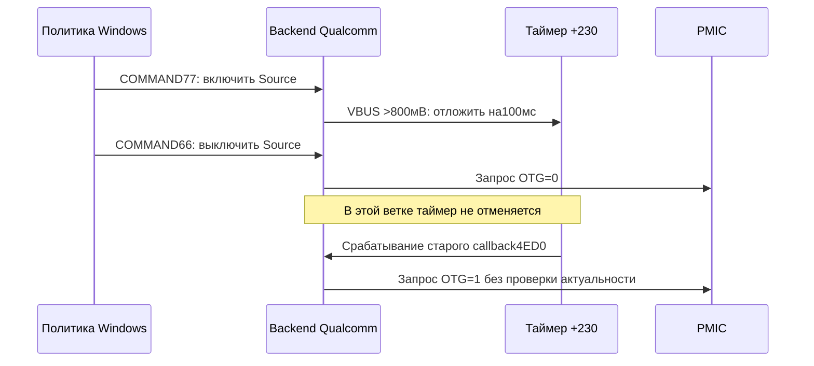

> Продолжение 27.10: обнаружены несогласованность Sink-команд44/55 с DeviceCap1=61BD и пробел формирования Fault-alert. Разобраны ещё пять функций Android; только статический анализ, без новых тестов/сборок/установок. [Следующий разбор](TYPEC-SINK-FAULT-2026-10-27.md).

# nabu: отложенное включение OTG, события и остановка драйвера

27.10.2026. Только статический разбор Ghidra, исходников и сохранённых
файлов. **Новых тестов, сборок, установок, аппаратных чтений/записей,
USB resets и перезагрузок не было.** Последняя подтверждённая связка:
PMIC1840/oem92, Type-C1680/oem110, backend1680/oem214, battery1680/oem143.
Кандидаты fix2/fix3 остаются заблокированы для установки.

Главный новый результат — конкретный путь отправки устаревшего запроса
включения OTG после выключения. Он находится в нижнем qcpmictcc, поэтому
одним исправлением верхнего qcusbctcpm задача не решается. Связь этого пути
с конкретным историческим сбоем планшета пока не доказана.

## 1. Отложенное включение может пережить выключение

Бинарный источник: qcpmictcc8150.sys, SHA256
`BE9850CE5AB8A9E5EAD615DE592FF8177154BDE9496320910210DC503B2B46E9`.
Все адреса Windows ниже — RVA этого файла.

Подтверждено машинным кодом:

| Участок | Поведение |
|---|---|
|143F0, вызов149C0|Создаёт одноразовый таймер context+230 с callback4ED0 |
|69D0, COMMAND23=77|Запрашивает виртуальный VBUS_VOLTAGE70 |
|6DDC–6DE4|Сравнивает младшие10 бит показания с32: это 800мВ при шаге25мВ |
|6E08–6E18|Если значение больше32, запускает timer+230 |
|константа6EB8|64-битное значение−1000000 в100-нс единицах: относительная задержка100мс |
|69D0, COMMAND23=66|Вызывает8AF8(context,0), без отмены timer+230 |
|4ED0, 519C–51A4|После измерения/логирования вызывает8AF8(context,1) |
|8AF8|Сначала вызывает AF20 с требуемым on/off, затем обрабатывает флаги и уведомления |

В4ED0 нет сравнения свежего напряжения с порогом, проверки актуального
запроса Source, номера подключения или признака остановки A81C перед
вызовом8AF8(...,1). Даже ветви ошибок измерения сходятся к этому вызову.
В8AF8 проверка context+2F4 относится к последующей настройке/уведомлению;
она **не защищает первый запрос включения OTG**.

Статически допустимая последовательность, **не аппаратный тест**:

Здесь доказан **запрос** к нижнему слою, а не фактическое появление VBUS:
PMIC может отклонить/ограничить его, и электрический результат не измерялся.
Но выключение не должно оставлять программный путь, способный позднее
повторить отменённое включение. Это конкретное требование к исправлению.

Дополнительная проблема: ошибка измерения не имеет отдельного безопасного
исхода. В69D0 локальное показание инициализировано нулём, часть ошибок лишь
логируется, после чего выполняется проверка порога. При неизвестном/старом
показании нельзя делать вывод «VBUS разряжен, включение разрешено».

Сканирование всех разобранных инструкций с обращениями к context+230
сохранено в timer-cancellation-references.txt. Найден вызов запуска и
создание, прямого вызова WdfTimerStop для этого поля не найдено.
Ограничение такого сканирования: оно не доказывает отсутствие произвольного
косвенного доступа через вычисленный указатель. Проверенные обычные пути
66→8AF8 и4ED0 отмены/проверки не содержат.

### До какого регистра доходит запрос

Дополнительно прослежен AF20 по архивному Ghidra-разбору исходного
PMIC1840 (SHA256533C3A555E111D4B12B657D026C92D63D5170D57297432D03BDAF3BE96C7886A):

`4ED0 → 8AF8 → AF20 → IOCTL801C0FA8, затем801C0FAC → PMIC7DD0 → B948`.

Первый IOCTL обнуляет1153 bit1 OTG_EN_SRC_CFG; второй передаёт требуемый
on/off для1140 bit0 OTG_EN. Константы IOCTL повторно прочитаны из PE1840:
82B8=801C0FA8,82BC=801C0FAC. Называть первый шаг только «проверкой» неверно:
это тоже запрос изменения настройки. Здесь не используется новая r5/r6.

AF20 проверяет оба результата каждого PMIC IOCTL: NTSTATUS передачи и
код операции в выходном буфере. PMIC7DD0 намеренно возвращает успешную
доставку IOCTL отдельно от результата SPMI-записи. Такой двухуровневый
контракт здесь обработан; нельзя считать любую пару «успешный IOCTL,
ошибка в буфере» дефектом самого диспетчера.

Для COMMAND23 обработка физической операции отложена относительно записи
виртуального регистра. Поэтому раннее подтверждение приёма допустимо:
его нельзя автоматически заменить ожиданием полного электрического перехода.
Если физическая операция позже отказала, нужен определённый исход —
повтор, fault/status alert или завершение ещё незавершённого запроса.
Повторно завершать уже завершённый WDFREQUEST нельзя. Доставка ошибки
в3550/F988 и отдельные IRQ должны рассматриваться вместе.

Машинные материалы сохранены как historical-pmic-role-otg-decompile.txt,
historical-typec-backend-otg-decompile.txt; контрольные суммы —
pmic-otg-chain-provenance.json. Аппаратных обращений не выполнялось.

## 2. Таймеры и системный поток — разные исполнители

149C0 создаёт WDF timer: AutomaticSerialization=TRUE, Period=0,
ExecutionLevel=WdfExecutionLevelPassive(2), SynchronizationScope=inherit(1).
Это подтверждено раскладкой структур из установленного WDK1.35 и ARM64-кодом.
**Ошибку DISPATCH_LEVEL этим таймерам не приписываем:** они passive.

103A8 отдельно создаёт системный поток FE40 через PsCreateSystemThread.
Автоматическая сериализация WDF callbacks не делает произвольный системный
поток участником той же блокировки. ВFE40 такой внешней блокировки нет.
[Область синхронизации WDF](https://learn.microsoft.com/en-us/windows-hardware/drivers/ddi/wdfobject/ne-wdfobject-_wdf_synchronization_scope).

Таймер4ED0 может пройти8AF8→FAD8→10E48, когда context+2F4=2. Основной поток
тоже вызывает10E48 через10C68 и обработчики состояний. Следовательно,
предыдущее подозрение о параллельных уведомлениях имеет конкретные
независимые пути вызова. Общие A830/A918 и очистка ALERT после callback
остаются местами риска. Точное пересечение этих путей в живой сессии пока
не установлено. Нужен единый сериализованный канал доставки уведомлений.

Microsoft требует последовательной доставки Alert и допускает обратные
аппаратные запросы до возврата этого вызова. Поэтому держать общий lock
вокруг вызова class extension нельзя без полного анализа повторного входа:
[контракт Alert](https://learn.microsoft.com/en-us/windows-hardware/drivers/ddi/ucmtcpciportcontroller/nf-ucmtcpciportcontroller-ucmtcpciportcontrolleralert).

## 3. Основной цикл не обеспечивает общий повтор после ошибки

После уточнения сигнатур импортов Ghidra показывает полный вызов:
`KeWaitForMultipleObjects(7,events,WaitAny,Executive,KernelMode,FALSE,NULL,blocks)`.
Тайм-аута нет. Раскладка событий:

| Индекс | Поле контекста | Производитель / назначение |
|---|---|---|
|0|320|Остановка |
|1|380|Протокольное событие, перевод из состояния2 в4 |
|2|3B0|Протокольное событие, перевод из состояния2 в5 |
|3|338|CC/status, запрос повторной обработки |
|4|350|Обработка pending-команд |
|5|368|Дополнительное протокольное событие |
|6|398|Срабатывание таймера состояния |

FE40 очищает выбранное событие, записывает его индекс в context+260 и
вызывает10C68. В100A4–100CC результат обработки не проверяется: начинается
следующее бесконечное ожидание. Первоначальный вызов11070 тоже не проверяется.
Внутри отдельных состояний есть свои повторы, например11D50 ограничивает
один повторяющийся путь пятью попытками. Поэтому формулировка «повторов нет
вообще» неверна. **Общей гарантии повтора после произвольной ошибки нет.**

Само очищение события **до** обработки не является доказательством потери
пробуждения: при повторном чтении текущего состояния объединение событий
может быть корректным. Проблема для дальнейшей реализации — что делать
после неуспешного чтения/команды, когда событие уже принято, а нового нет.

Также Microsoft гарантирует не более одного незавершённого аппаратного
запроса UcmTcpciCx на порт. Нельзя объяснять гонку двумя одновременно
выданными запросами этого class extension. Таймеры, IRQ и отдельный поток
всё равно требуют согласования:
[описание модели запросов](https://learn.microsoft.com/en-us/windows-hardware/drivers/usbcon/write-a-usb-type-c-port-controller-driver).

## 4. Остановка потока не подтверждает его завершение

107A8 выполняет: A81C=0, сигнал stop-event320, очистку других событий,
ZwClose(A820), context+288=0 и возврат. Ожидания завершения FE40 здесь нет,
значение A820 после закрытия не обнуляется.

Проверены оба прямых вызывающих пути:132B0 и13E30. Дополнительные3390 и2370
снимают регистрации/сбрасывают состояние; ожидания системного потока в них
не найдено. Ссылки на A820 в модуле — создание и закрытие; единственный
KeWaitForMultipleObjects принадлежит самому FE40. Динамически разрешаемые
имена в1C4F8 относятся к трассировке/версии, дополнительного join там нет.

Закрытие HANDLE не равнозначно завершению исполнения потока:
[ZwClose](https://learn.microsoft.com/en-us/windows-hardware/drivers/ddi/wdm/nf-wdm-zwclose),
[PsCreateSystemThread](https://learn.microsoft.com/en-us/windows-hardware/drivers/ddi/wdm/nf-wdm-pscreatesystemthread).
Следовательно, выход stop-path нельзя использовать как доказательство,
что контекст уже никто не читает. Возможность использования освобождённой
памяти зависит от последующего освобождения контекста; прошлые BSOD этим
пока не объяснены. При повторном stop также требуется исключить повторное
закрытие старого handle.

103A8 дополнительно возвращает0 даже через ветви неудачного создания
потока/таймера. A81C выставляется до PsCreateSystemThread. При отказе
выделения wait-blocks FE40 завершается без отдельного уведомления о
неготовности. Это подтверждённые пробелы сообщения об ошибках старта,
но их возникновение на планшете не установлено.

## 5. Ещё четыре функции Android разобраны в Ghidra

ELF: `FB34578DD6704109363A32CAA29937B16B27336C34C721CC02BD41FDDF83BDE46`.

| Адрес | Функция | Что сопоставлено с исходником |
|---|---|---|
|FFFFFF8008A9D098|kick_sm|Немедленная постановка работы или относительный таймер |
|FFFFFF8008A9EB00|usbpd_sm|Отмена таймера на входе, извлечение RX под lock, отдельный сброс при current_pr=PR_NONE |
|FFFFFF8008AA3D00|phy_sig_received|Hard reset помечается в состоянии и передаётся в обработку |
|FFFFFF8008AA3E28|phy_msg_received|Сообщение копируется в собственный буфер, включается в RX-очередь под lock, будит обработчик |

В nabu policy_engine.c очередь создаётся через alloc_ordered_workqueue.
В конце usbpd_sm повторно проверяется RX-очередь: оставшиеся сообщения
снова ставят обработку в очередь. Полезный принцип для Windows — явное
состояние и сохранение незавершённой работы, а не независимые от роли
отложенные записи OTG.
[Точный исходник nabu](https://github.com/MiCode/Xiaomi_Kernel_OpenSource/blob/71b6effd2dfa8f703dd1ea17acd1323b2fd3cf6c/drivers/usb/pd/policy_engine.c).
Git blob исходника ae9a0044937cee20712a850f98d4012b747e6a40 сверялся ранее.
Границы функций взяты из символов; для длинного usbpd_sm текстовый вывод
дизассемблера ограничен1000 инструкций, декомпиляция охватывает тело функции.

В Linux также есть историческое исправление ожидания vSafe0V перед новым
toggling: отключение CC и спад VBUS происходят не одновременно. Оно полезно
как пример проверки завершённого электрического перехода вместо слепой
задержки; это не готовый патч для нашего Windows backend:
[upstream3287f58](https://github.com/torvalds/linux/commit/3287f58bcba6c6fa6167624b443a668782fac26d).

## 6. Что теперь должно входить в исправление

1. Один владелец аппаратного управления Source/OTG. Таймеры лишь ставят
   события, а не выполняют независимые записи питания.
2. Номер поколения подключения/запроса. Выключение Source, переход в Sink,
   detach и Stop аннулируют старые отложенные включения. Проверка выполняется
   в том же сериализованном пути, который выдаёт запрос PMIC.
3. Для включения нужны действующий запрос и достоверное свежее состояние
   VBUS. Ошибка чтения не превращается в нулевое напряжение. По deadline —
   явный отказ/восстановление, а не безусловное включение.
4. WdfTimerStop(FALSE) не заменяет защиту от уже выполняющегося callback.
   При завершении работы нужны отмена, ожидание допустимых callbacks и join
   потока до освобождения контекста. Не ждать собственного таймера из его
   callback: [правила TimerStop](https://learn.microsoft.com/en-us/windows-hardware/drivers/ddi/wdftimer/nf-wdftimer-wdftimerstop).
5. Сохранять реальный результат команд и обоих каналов backend; определить
   ограниченный повтор после временного отказа, не теряя pending-работу.
6. Уведомления CC/Power/PD — через один канал с согласованным снимком и
   сохранением новых событий, без общего lock вокруг вызова Windows.

Эти пункты — спецификация следующей реализации, **не установленный и не
проверенный драйвер**. Не менять драйверы и не запускать тесты по этому
документу. Следующий разбор: входные условия режимов Sink/Source,
доставка аппаратных fault и завершение запросов Windows. Не заменять это
автоматическим переключением USB/PMIC на работающем планшете.
